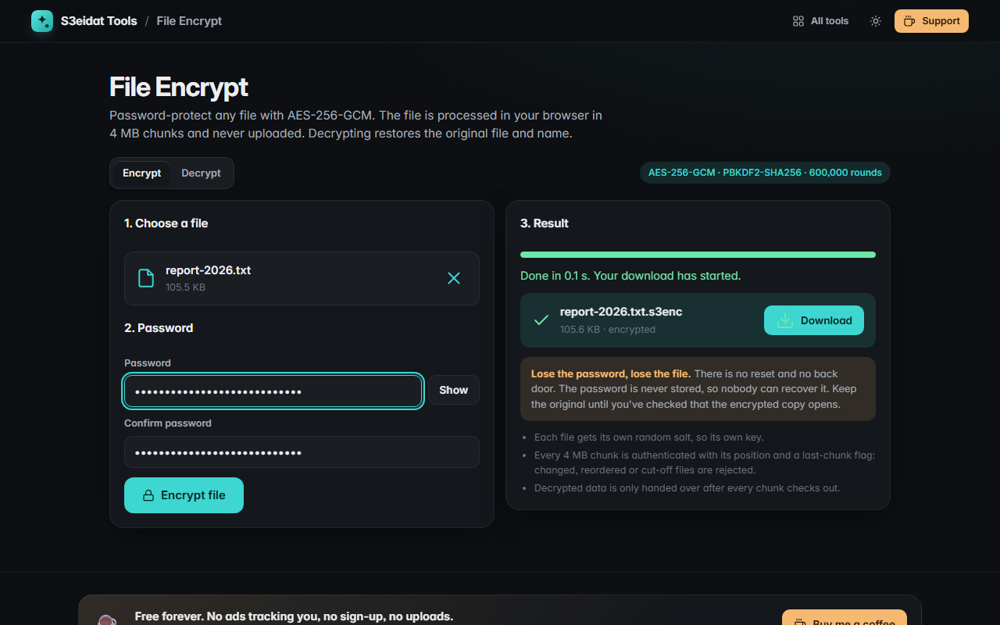

# File Encrypt

> Encrypt files with a password, offline (AES-256-GCM). Free, private, and it runs entirely in your browser.

### ▶ [Open File Encrypt](https://s3eidat.github.io/file-encrypt/)



## Features

- **Encrypt any file** into a `.s3enc` file with a password; **decrypt** restores the original bytes, file name and type
- **Chunked**: the file is read and encrypted 4 MB at a time, so large files don't need to be loaded at once
- **Integrity checked**: a wrong password, a flipped byte, chunks swapped around, a cut-off file or extra bytes at the end
  all give a clear error. Decrypted data is only handed over after every chunk passes
- Progress bar, cancel, speed, password confirmation, show/hide
- Drop an `.s3enc` file and it switches to Decrypt by itself

**If you lose the password, the file is gone.** There is no reset and no back door.

Limits: the finished file is assembled in the browser before it's saved, so the practical maximum depends on your
browser and free memory (several GB on a desktop Chrome or Firefox is usually fine; phones are lower).

## Cryptography

All of it is the browser's Web Crypto API (`crypto.subtle`); there is no custom crypto code.

| Part | Choice |
|---|---|
| Cipher | AES-256-GCM, 128-bit tag, per chunk |
| Key | PBKDF2-HMAC-SHA256, **600,000 iterations**, 16-byte random salt **per file** |
| IV | 8-byte random per-file prefix + 4-byte big-endian chunk counter. The key is unique per file (fresh salt), and the counter never repeats within a file, so an IV is never reused under a key |
| Chunk binding | AAD = whole header + chunk index + "last chunk" flag, so chunks can't be reordered, dropped, duplicated, or the file truncated or extended without failing |
| Randomness | `crypto.getRandomValues` |

## Wire format (`.s3enc`, version 1)

All integers are unsigned big-endian.

```
Header, 40 bytes
offset size field
0      4    magic          "S3EF" (53 33 45 46)
4      1    version        0x01
5      1    kdf            0x01 = PBKDF2-HMAC-SHA256
6      2    reserved       0x0000 (must be zero)
8      4    iterations     600000
12     4    chunk size     plaintext bytes per data chunk (4194304 = 4 MiB)
16     16   salt           random, per file
32     8    nonce prefix   random, per file

Then records, back to back until the end of the file:
4      length L of the ciphertext that follows (includes the 16-byte tag)
L      AES-256-GCM ciphertext + tag

record 0       = metadata, UTF-8 JSON: {"name": "...", "size": <bytes>, "type": "<mime>", "modified": <ms>}
record 1..n    = file data; every data record is exactly `chunk size` bytes of plaintext except the last (1..chunk size).
                 An empty file has only record 0.

For record i:
  key = PBKDF2-HMAC-SHA256(UTF-8 of the NFC-normalized password, salt, iterations) -> 32 bytes
  IV  = nonce prefix (8) || uint32(i)
  AAD = header (40) || uint32(i) || uint8(1 if this is the last record in the file else 0)
```

A decoder must: check the magic, version, kdf and reserved bytes; refuse iteration counts outside 100,000–10,000,000 and
chunk sizes outside 1 KiB–64 MiB; reject any record length that is under 16 or over the chunk size + 16 (64 KiB + 16 for
metadata); treat a record as "last" only if it ends exactly at the end of the file; and check that the data records add up to
`size` from the metadata. A failure on record 0 means a wrong password (or a damaged header).

The built-in self-test checks: round trips (multi-chunk, exact multiple of the chunk size, empty file), unique salt and nonce per
file, safe restoring of hostile file names, and that a wrong password, a flipped data or header byte, a dropped last chunk,
a cut mid-chunk, swapped chunks, appended bytes and absurd iteration counts are all rejected, plus a fixed known file that
must keep decrypting.

## Privacy

Your files and password never leave your device and are never stored (not even in local storage).
There is no server, no account, no analytics. The page ships with a strict Content-Security-Policy
(`connect-src 'self'`), so the browser itself blocks any attempt to send data anywhere.

## Run it yourself

It's plain HTML, CSS and JavaScript with no build step:

```bash
git clone https://github.com/s3eidat/file-encrypt
cd file-encrypt
python -m http.server 8000
```

Then open http://localhost:8000. (Web Crypto needs `https://` or `localhost`.)

## Support

If this saved you time, **[buy me a coffee ☕](https://s3eidat.github.io/coffee/)**. It keeps every tool free.

---

Part of **[S3eidat Tools](https://s3eidat.github.io/)**: 100+ free, private tools that run in your browser. MIT licensed.
